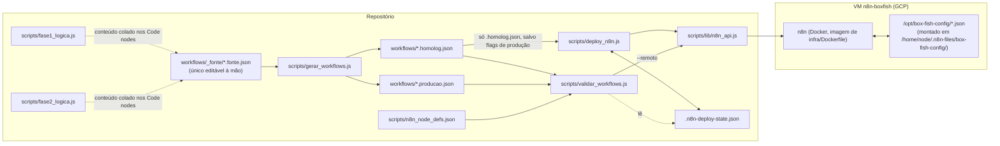
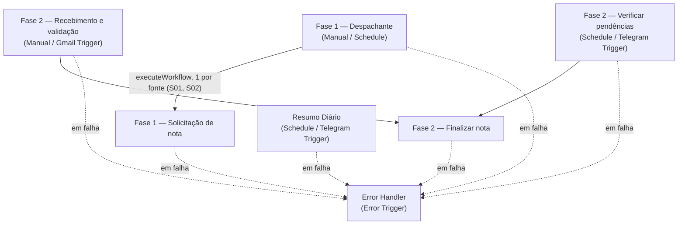

# Mapa do código — automação de notas fiscais Box Fish

Mapa estrutural gerado em 28/10/2026, só por leitura. Escopo: `scripts/`, `workflows/`, `profiles/`,
`config/`, `infra/` e `docs/`. Não cobre `.env`, `_lixo/`, `_saidas/`, a raiz nem `node_modules/`.
Ele descreve o que existe e como as partes se ligam. **Não é auditoria nem lista de problemas.**
As regras de negócio estão no spec (`docs/spec.md` → `docs/spec/`).

## 1. Visão geral

O produto é um conjunto de **workflows do n8n**, que é onde a automação roda. Os scripts Node
do repositório não rodam em produção: eles **geram, validam e publicam** esses workflows. Os
`*_logica.js` guardam, versionada, a lógica que é colada nos Code nodes.



## 2. `scripts/`: ferramentas de build, validação e deploy

| Arquivo | Linhas | Papel | Depende de |
|---|---|---|---|
| `gerar_workflows.js` | 254 | Gera `<nome>.homolog.json` e `<nome>.producao.json` a partir de `workflows/_fonte/<nome>.fonte.json`. Sem argumento, processa todas as fontes. | `fs`, `path` |
| `validar_workflows.js` | 591 | Confere os parâmetros de cada node contra as definições oficiais e as referências `$('...')`. Com `--remoto`, compara com o publicado. | `n8n_node_defs.json`, `lib/n8n_api.js` (no modo `--remoto`), `.n8n-deploy-state.json` |
| `deploy_n8n.js` | 311 | Publica os workflows gerados via API do n8n. Flags: `--dry-run`, `--producao --confirmo-producao`. | `lib/n8n_api.js`, `.n8n-deploy-state.json` |
| `lib/n8n_api.js` | 196 | Cliente mínimo da API pública do n8n e leitura do `.env`. | `fs`, `path` |
| `lib/xlsx_cirurgico.js` | 262 | Escrita "cirúrgica" em .xlsx: reescreve só o XML da aba e preserva a formatação condicional. | `jszip`, recebido por parâmetro |
| `fase1_logica.js` | 615 | Lógica determinística da Fase 1, uma seção por Code node. Não é importado por ninguém. | — |
| `fase2_logica.js` | 254 | Lógica determinística da Fase 2, mesmo padrão. Não é importado por ninguém. | — |
| `n8n_node_defs.json` | — | Definições oficiais dos node types, extraídas do `n8n-nodes-base`. | — |
| `referencia/coluna-q-cirurgica.js` | 1333 | Referência do gerador ZZ-TEMP da coluna Q (21–22/10), copiado de `zz-temp-coluna-q.js`. | `crypto`, `fs`, `path`, `exceljs`, `jszip`, `./scripts/lib/n8n_api.js` |
| `referencia/escrita-cirurgica-com-backup.js` | 576 | Referência do gerador ZZ-TEMP da escrita do arquivamento por função (19/10), copiado de `zz-temp-escrita.js`. | `crypto`, `fs`, `path`, `./scripts/lib/n8n_api.js` |

**Funções principais por arquivo:**
- **gerar_workflows.js:** `resolverCredenciais` (marcador `__porAmbiente`), `colapsarIfsDeAmbiente` (marcador `__ifAmbiente`),
  `removerInalcancaveis` (por arestas puras), `assarAmbiente`, `resolverSufixoDeAmbiente` (`__SUFIXO_AMBIENTE__`),
  `limparMarcadores` e `gerar`.
- **validar_workflows.js:** `validarNode`, `validarResourceLocators`, `validarCredencialDeclarada`,
  `validarReferenciasANodes`, `ancestrais`, `validarArquivo`, `compararComPublicado` e `validarRemoto`.
- **deploy_n8n.js:** `resolverCredenciais`, `resolverErrorWorkflow`, `resolverSubWorkflows` (troca os
  `REPLACE_WITH_*_WORKFLOW_ID` pelos IDs da instância) e `publicar`.
- **lib/n8n_api.js:** exporta `carregarEnv`, `mascarar`, `N8nApi`, `prepararPayload`, `CAMPOS_ACEITOS_NODE` e `RAIZ`.
- **lib/xlsx_cirurgico.js:** exporta `gravarPreservando`, `acrescentarEstilo`, `inventario`, `caminhoDaAba`,
  `estiloDaCelula`, entre outras. O comentário da linha 29 aponta para `comandos-vm-instalar-jszip.txt`.
- **fase1_logica.js, Fase 1:**
  - normalização e datas;
  - "PROGRAMAR ATÉ" e variantes de "SOLICITAR";
  - projeto pela cor (`detectarProjetoPorCor`);
  - cruzamento com Contratos e ficha cadastral;
  - prompt e parsing da coluna J (IA);
  - apelidos e assunto;
  - montagem de e-mail do colaborador e do fornecedor;
  - modo automático e envio (`decidirAcaoEnvio`);
  - cobrança (`avaliarCobranca`).
- **fase2_logica.js, Fase 2:**
  - identificação de thread conhecida;
  - prompts de extração da NF e de casamento com a planilha, e parsing da IA;
  - número da nota e retranca (`gerarRetranca`);
  - nomes de pasta de vencimento e de função;
  - pendência de identificação;
  - correlação da resposta da Michelle.

**Ligações entre arquivos:** o grafo de `require` entre arquivos do projeto é pequeno.
- `deploy_n8n.js` e `validar_workflows.js` importam `lib/n8n_api.js`.
- Os dois arquivos de `referencia/` declaram `require('./scripts/lib/n8n_api.js')`, caminho relativo ao local
  original deles, na raiz.
- `xlsx_cirurgico.js` não é importado por arquivo do repositório: o conteúdo dele é embutido nos workflows ZZ-TEMP.

## 3. `workflows/`: os workflows do n8n

### 3.1 Fonte → gerados
| Fonte (`workflows/_fonte/`) | Nodes na fonte | Homolog (nodes) | Produção (nodes) |
|---|---|---|---|
| `fase1_despachante.fonte.json` | 5 | `fase1_despachante.homolog.json` (5) | `fase1_despachante.producao.json` (5) |
| `fase1_solicitacao_nota.fonte.json` | 151 | `fase1_solicitacao_nota.homolog.json` (124) | `fase1_solicitacao_nota.producao.json` (121) |
| `fase2_finalizar_nota.fonte.json` | 22 | `fase2_finalizar_nota.homolog.json` (22) | `fase2_finalizar_nota.producao.json` (22) |
| `fase2_recebimento_validacao.fonte.json` | 29 | `fase2_recebimento_validacao.homolog.json` (29) | `fase2_recebimento_validacao.producao.json` (29) |
| `fase2_verificar_pendencias.fonte.json` | 28 | `fase2_verificar_pendencias.homolog.json` (28) | `fase2_verificar_pendencias.producao.json` (28) |

Na `fase1_solicitacao_nota` a fonte tem mais nodes que os gerados, porque os IFs de ambiente e o ramo do outro
ambiente são removidos. O homolog usa Google Drive; a produção usa Box, com 6 nodes `box` e menos `googleDrive`.

Fora do esquema fonte → gerados, editados direto:
- `error_handler.json` (3 nodes);
- `resumo_diario.json` (8 nodes).

### 3.2 Gatilhos, chamadas e credenciais
| Workflow | Gatilhos | Chama (sub-workflow) | Credenciais (tipos) | errorWorkflow |
|---|---|---|---|---|
| Fase 1 — Despachante por fonte | Manual, Schedule | `fase1_solicitacao_nota` (mode each, uma fonte por item) | — | sim |
| Fase 1 — Solicitação de nota | executeWorkflowTrigger (recebe `fonteId`) | — | Gmail, Google Drive, Anthropic, Telegram, Box (produção) | sim |
| Fase 2 — Recebimento e validação | Manual, Gmail Trigger | `fase2_finalizar_nota` | Gmail, Box, Telegram, Anthropic | sim |
| Fase 2 — Verificar pendências de identificação | Schedule, Telegram Trigger | `fase2_finalizar_nota` | Telegram, Box | sim |
| Fase 2 — Finalizar nota (sub-workflow compartilhado) | executeWorkflowTrigger | — | Google Drive, Box | sim |
| Error Handler | Error Trigger | — | Telegram | — (é ele) |
| Resumo Diário | Schedule, Telegram Trigger | — | Telegram | sim |



### 3.3 Composição por tipo de node (fontes)
- **fase1_solicitacao_nota (151):** code ×57, httpRequest ×26, if ×20, googleDrive ×11, gmail ×11, readWriteFile ×6,
  merge ×6, box ×6, telegram ×5, switch, noOp, executeWorkflowTrigger.
- **fase2_recebimento_validacao (29):** code ×9, readWriteFile ×4, merge ×3, gmail ×2, box ×2, if ×2, httpRequest ×2,
  telegram, executeWorkflow, triggers.
- **fase2_verificar_pendencias (28):** code ×9, readWriteFile ×4, telegram ×4, if ×2, merge ×2, box ×2, switch,
  executeWorkflow, triggers.
- **fase2_finalizar_nota (22):** googleDrive ×6, merge ×4, code ×3, httpRequest ×3, if ×2, readWriteFile ×2, box.
- **fase1_despachante (5):** code ×2, executeWorkflow, 2 triggers.

## 4. `config/`: estado e configuração em JSON (espelho do que vai para a VM)

Na VM, os arquivos ficam em `/opt/box-fish-config/` no host. No container, ficam em
`/home/node/.n8n-files/box-fish-config/`. Nos workflows o nome leva `__SUFIXO_AMBIENTE__`, que o gerador troca
por `_hml` (homolog) ou vazio (produção).

| Arquivo (prod / `_hml`) | Conteúdo (chaves) | Lido por | Gravado por |
|---|---|---|---|
| `config_execucao.json` | `ambiente`, `modo`, `limite_linhas_execucao` (o hml tem também `homolog`) | Fase 1 Solicitação, Fase 2 Recebimento | — |
| `apelidos.json` | `AREP`, `REUNION`, `SOFT_PRE` | Fase 1 Solicitação | — |
| `cobrancas.json` | objeto (vazio no repositório) | Fase 1 Solicitação, Fase 2 Recebimento, Fase 2 Finalizar | Fase 1 Solicitação, Fase 2 Finalizar |
| `log_diario.json` | lista (vazia no repositório) | Fase 1 Solicitação, Resumo Diário (só o de produção) | Fase 1 Solicitação |
| `pendencias_identificacao.json` | objeto (vazio no repositório) | Fase 2 Recebimento, Fase 2 Verificar pendências | Fase 2 Recebimento, Fase 2 Verificar pendências |

## 5. `profiles/`: perfis de projeto (spec seção 6)
Os três perfis são `arep.json`, `reunion.json` e `soft-pre.json`, com as mesmas chaves:
`projeto`, `prefixo_assunto_pedido`, `prefixo_assunto_entrega`, `texto_ref`, `retranca`,
`planilha_cost_report` e `planilha_contratos`.

## 6. `infra/`
- **`Dockerfile`:** imagem customizada do n8n. Parte de `n8nio/n8n:latest` e instala `exceljs` (Cost Report .xlsx,
  lê cor de célula) e `xlsx`/SheetJS (Contratos .xlsb) em `/usr/local/lib/node_modules_extra`. É uma cópia versionada
  do `~/n8n-custom/Dockerfile` da VM, que é o arquivo que vale. Exige `NODE_FUNCTION_ALLOW_EXTERNAL=exceljs,xlsx` no `docker run`.

## 7. `docs/`
| Arquivo | Linhas | Conteúdo |
|---|---|---|
| `spec.md` | 13 | Porta de entrada: aponta para `docs/spec/` (dividido em 24/10/2026) |
| `spec/00-comum.md` | 179 | §0 mapa de leitura, §1 objetivo e escopo, §2 as 4 fases, §6 perfis de projeto |
| `spec/fase-1.md` | 323 | §3 Fase 1 — Solicitação de nota |
| `spec/fase-2.md` | 97 | §4 Fase 2 — Recebimento e validação, §4.2 salvamentos, §4.3 credenciais, §4.4 estrutura do Drive |
| `spec/fase-3-4.md` | 50 | §5 Fase 3 + 4 — Remessa para o Danilo e arquivamento |
| `spec/01-arquitetura-infra.md` | 181 | §7 arquitetura técnica, §8 acessos validados, §13 rollback e versão |
| `spec/90-decisoes-e-proximos-passos.md` | 30 | §10 regras resolvidas, §11 checklist |
| `CODEBASE_MAP.md` | — | Este mapa |

## 8. Ciclo de trabalho (como as peças se encadeiam)
```bash
node scripts/gerar_workflows.js                                   # _fonte → homolog + produção
node scripts/validar_workflows.js                                 # valida todos os gerados
node scripts/deploy_n8n.js workflows/<nome>.homolog.json          # publica (trava: só homolog)
node scripts/validar_workflows.js --remoto workflows/<nome>.homolog.json   # confere o publicado
```

## 9. Como este mapa foi feito
- **Plugin cartographer v0.8.0, fase 1 só.** Não houve revisores, backlog nem correções. O mapeador rodou sobre uma
  cópia apenas das 6 pastas do escopo. Ele só entende JS e não resolve `require` do Node, então as ligações da
  seção 2 foram levantadas à mão.
- **Saída bruta:** `_saidas/cartographer/` (241 símbolos em 9 arquivos JS; integrações detectadas: filesystem,
  google_api, telegram).
- **Workflows, config e docs:** a estrutura foi extraída por leitura dos JSON (nodes, tipos, gatilhos, credenciais
  por tipo e caminhos de `readWriteFile`) e dos títulos dos .md. Nenhum segredo foi lido: as credenciais aparecem só
  pelo tipo.
